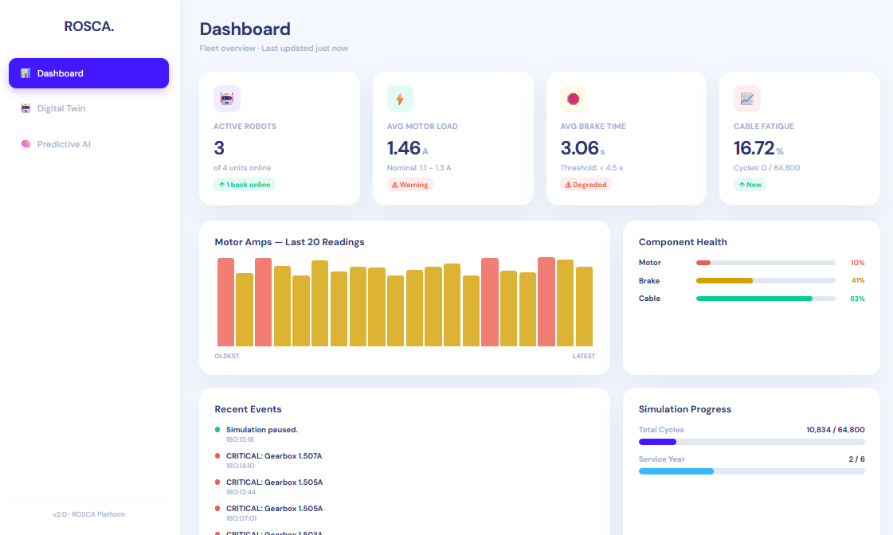

# Galvanic-Robot-Digital-Twin-Predictive-Maintenance

Predictive maintenance system and digital twin for an industrial galvanic coating robot, analyzing telemetry for brakes, cables, and gearboxes.

## 💻 System Architecture
* **Digital Twin Logic:** Python (`brake_twin.py`, `cable_twin.py`, `gearbox_twin.py`)
* **Web Interface:** HTML (`website.html`)
* **Datasets:** Component degradation telemetry (`rosca_brake_training_data_V2.csv`, `rosca_cable_training_data.csv`, `rosca_gearbox_training_data.csv`)

## 📊 Fleet Dashboard

## 🤖 Real-time Digital Twin Simulation

## 🧠 Predictive Maintenance Assistant

## 📄 Documentation
For the complete engineering methodology and system analysis, refer to the [Internship Report](Rapport%20de%20Stage%20-%20Khalil%20Elyoumni%20-%20final.pdf).
